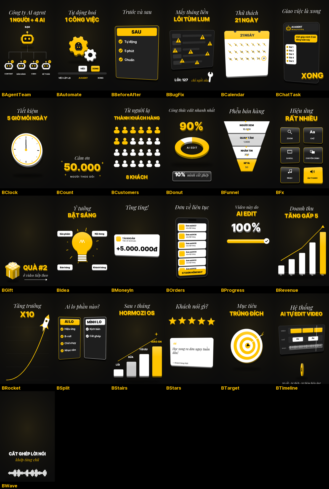

# reel-doc-3d — skill Claude Code tự edit video dọc (Reels / TikTok / Shorts)

Đưa cho Claude Code một video **quay dọc**, bạn nói chuyện trước máy, rồi nói **"edit video này"**. Skill sẽ tự làm từ đầu đến cuối:

- **Cắt:** bỏ khoảng lặng, ậm ừ, câu vấp; câu nói nhiều lần thì giữ lần trôi chảy nhất. Tăng tốc nhẹ ×1,1–1,2.
- **Hình:** chỉnh màu, làm mịn da. Tách phông bằng mô hình cho video (RobustVideoMatting). Nền xen kẽ: phông thật, nền tối, chữ to nằm sau đầu.
- **Chữ:** hiện theo từng cụm, 2 font (Inter Tight + Playfair nghiêng), 3 màu trắng – đen – vàng. Chữ mảnh có hiệu ứng sang, chữ đậm có hiệu ứng năng động.
- **Minh hoạ khối 3D:** thư viện 25 mẫu (bộ đếm số, biểu đồ doanh thu, đơn hàng về, tiền về, lịch, đồng hồ, phễu, tên lửa, đội robot AI agent, khung chat giao việc…). Nội dung của bạn chưa có mẫu hợp thì Claude **tự vẽ mẫu mới** và giữ lại cho video sau.
- **Cảnh quay / ảnh của chính bạn:** chèn được với 8 kiểu đặt cảnh: toàn màn hình, chia đôi, thẻ nghiêng 3D, khung điện thoại, ảnh polaroid, nhãn dán, bong bóng mặt, dồn nhanh nhiều cảnh. Tự chọn đoạn nét nhất, chỉnh màu cho khớp video chính.
- **Âm thanh:** nhiều hiệu ứng tự tổng hợp, nhạc nền −15 dB so với giọng, cân âm chuẩn mạng xã hội −14 LUFS.
- **Xuất file:** 1080×1920; có bản nháp 720p để duyệt trước.

## Cài đặt
Làm theo **[HUONG-DAN-CAI-DAT.md](HUONG-DAN-CAI-DAT.md)**. Hướng dẫn viết từng bước cho người không rành máy, dùng Windows.

Cần có: Claude Code, Python 3.10–3.12, ffmpeg, máy RAM từ 16 GB. Có card đồ hoạ NVIDIA thì gỡ băng nhanh hơn.

## Dùng
1. Kéo video quay dọc vào Claude Code và nói "edit video này".
2. Claude gỡ băng và báo những chữ phải đoán, rồi dựng bản nháp 720p cho bạn xem.
3. Bạn duyệt xong thì Claude ra bản chính 1080×1920.

Muốn chèn cảnh của bạn: bỏ ảnh hoặc video vào một thư mục rồi nói cho Claude biết. Có thể chỉ định cảnh nào chèn ở câu nào, hoặc để Claude tự ghép rồi báo bạn duyệt.

## Giấy phép
- Mã của skill: **MIT** (xem [LICENSE](LICENSE)).
- Phần do bên thứ ba làm được tải riêng khi cài, kèm giấy phép của họ:
  - font Inter Tight, Playfair Display: SIL Open Font License;
  - mô hình RobustVideoMatting: GPL-3.0;
  - rembg / u2net.
- Skill **không kèm nhạc**. Nhạc nền là của bạn, tự chịu trách nhiệm bản quyền.
